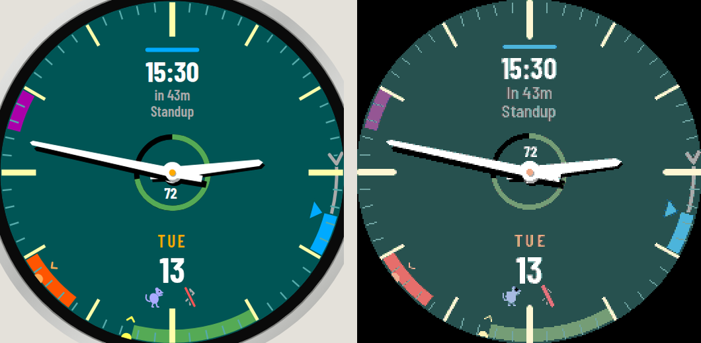
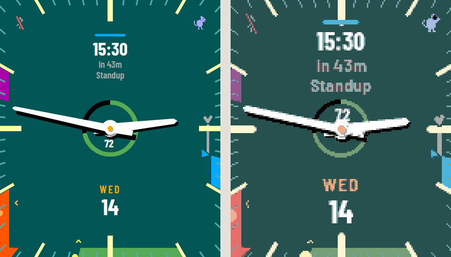

# psyble

An analogue Pebble watch face whose complications dodge the hands: the date and next-event
card jump to the clearest of 8 spots, calendar events for the next 12 hours are shaded round
the dial, and a grey line runs from now to the next event.

| Pebble Round 2 (design ◂ ▸ emulator) | Pebble Time Steel (design ◂ ▸ emulator) |
| --- | --- |
|  |  |

Also builds for Time Round (`chalk`), Time 2 (`emery`) and the black-and-white Pebble 2 /
2 Duo (`diorite`, `flint`), where colours dither. The original Pebble / Steel (`aplite`) is not
targeted.

## Design source

`design/` holds the Claude Design mock-ups this face implements. `canvas.html` is the full
canvas (open it in a browser); `round-D.html` and `time-steel-H.html` are the readable sources
of frames D and H, whose `renderVals()` geometry `src/c/face.c` follows unit for unit.

Where the mock-up's open questions needed an answer for the build:

- Countdown position defaults to the card (D); start/end of line (E/F) are a setting.
- Time Steel hands are fixed-length by default; stretched hands are a setting.
- Text on Time Steel is larger than frame H, which is drawn at 3× and would be 6–7 px on the
  watch. Every label is at least 12 px.
- The dial is any colour, defaulting to dark blue with pale yellow marks; frame G's teal and black are
  among the choices.
- Small labels use Barlow Semi Condensed, which holds up better than Barlow Condensed at
  12–13 px. Numbers stay Barlow Condensed Bold.

## Setup

```sh
uv tool install pebble-tool
pebble sdk install latest
npm install
pebble build
```

`@rebble/clay` (not `pebble-clay`) is required: the original Clay package doesn't declare the
`gabbro` platform and fails the build.

### Emulator

```sh
pebble install --emulator gabbro      # or basalt, chalk, emery, diorite, flint
pebble screenshot --emulator gabbro --no-open shot.png
```

`qemu-pebble` needs SDL2 and its audio dependencies. Without root, download the debs
(`apt-get download libsdl2-2.0-0 libpulse0 libsamplerate0 libxss1 libdecor-0-0 libasyncns0
libsndfile1 libflac12t64 libvorbis0a libvorbisenc2 libopus0 libogg0 libmpg123-0t64 libmp3lame0`),
extract them with `dpkg-deb -x`, and run with
`LD_LIBRARY_PATH=<extracted libs> SDL_VIDEODRIVER=offscreen SDL_AUDIODRIVER=dummy`.

`pebble install --emulator` gives the phone simulator (pypkjs) only 0.5 s to start; when that
isn't enough it fails with `Connection refused`. Starting pypkjs by hand on the port recorded in
`/tmp/pb-emulator.json`, and writing its pid there, lets later installs reuse it.

The screenshot tool simulates each display's colour response, so colours look washed out
compared with the mock-up.

### Demo mode

`PSYBLE_DEMO=1447 pebble build` freezes the clock at 14:47 and injects the mock-up's sample
calendar, battery and status icons, for comparing against `design/canvas.html`. `1008` also
drops the battery to 18%; any `HHMM` works.

### Tests

```sh
node --test test/
```

## Fonts

Pebble's font compiler only produces 1-bit glyphs, so on colour watches text comes from
`resources/aafonts/*.bin`: glyphs pre-rendered with 2-bit coverage (the display's depth per
colour channel) and blended into the frame buffer by `src/c/aafont.c`. Regenerate them after
changing a font, size or character set:

```sh
uv run --no-project --with freetype-py python tools/gen_aafonts.py
```

Black-and-white watches use the TTF fonts through the SDK's renderer. Barlow is under the SIL
Open Font Licence (`resources/fonts/OFL.txt`).

## How it works

- `src/c/face.c` draws everything in one layer. Positions are written in the mock-up's units
  (a 260-unit circle, or a 144×168 rectangle) and scaled to the display.
- `src/pkjs/` runs on the phone: it computes sunrise/sunset from location, fetches up to three
  iCal feeds (expanding recurrences with `ical.js`), and sends the next 24 hours of timed events
  to the watch every 30 minutes. All-day events are ignored.
- Settings (dial colour, accent, countdown position, hand reach, calendar addresses and
  colours) live in the phone app's settings page for the face.

Google Calendar's iCal export doesn't include event colours, so each calendar takes one colour
chosen in settings. Use the calendar's *Secret address in iCal format*.
